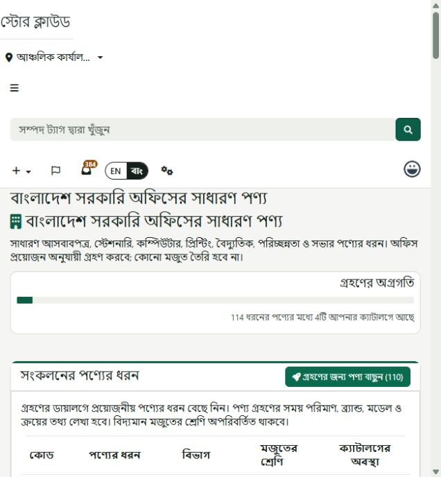

# Common office collection implementation and verification

Recorded 26 October 2026, Asia/Dhaka.

## Implemented

- One optional `bd-common-office` collection, displayed as **Bangladesh Government
  Common Office**, with 114 item types: 34 assets, 54 consumables, 24 accessories
  and 2 components. Groups: furniture 12, stationery 43, ICT 13, printing/office
  equipment 11, electrical/power 7, cleaning/sanitation 19 and general/meetings 9.
- UTF-8 CSVs, a frozen hash-checked manifest, Bangla names and local search aliases,
  and the exact 193-node UNSPSC ancestor closure from the existing bundled catalog.
- Two migrations install the schema additions and the collection. No extra command
  is required. Installation makes no office adoption, category, model or stock.
  Existing automatic starter-template configuration is unchanged.
- Collection preview uses recommended inventory types for new categories and
  preserves existing mapped types. Office progress includes its own and inherited
  company/global availability; company adoption does not mistake one office's
  adoption for company-wide adoption. Bangla collection search excludes inactive
  collections. Supplied collection/code IDs are validated on the server.
- New-office choice uses the existing protected bulk adoption routes. No new route,
  gate, national review bypass or Finance-code approval is added.

Data and maintenance details:
[versioned dataset README](../../packages/gov-store/classification/src/database/data/office-defaults/v1/README.md).

## Automated verification

PHP 8.4.15, Xdebug disabled:

```text
php -d xdebug.mode=off -d memory_limit=1G vendor/bin/phpunit tests/Feature/GovStore
```

**734 tests, 70,821 assertions passed**, including the required G1 authorization
suite and 12 new collection tests. All test writes used the suites' isolated
SQLite setup, never the existing local MySQL database.

New coverage includes:

- Actual `migrate` invocation of all classification migrations, starting from an
  empty catalog; dependency ordering, ancestor closure and a repeated no-op migration.
- Exact selected-node comparison with the bundled UNSPSC CSV, bilingual search,
  translation-key parity, compiled Blade PHP syntax and rendered adoption dialogs.
- CSV tamper rejection; atomic rollback on conflicting existing nodes; preservation
  of local labels, notes, version, collection edits and recommended types.
- Real category/adoption service execution with a mixed selected subset; repeat
  preview; independent second-office adoption; preservation of existing mapped
  types; no physical stock/model creation; company-versus-office progress.
- Unknown/nonmember IDs, inactive collections, and existing employee/native-admin/
  office-admin/storekeeper/company-admin ability decisions.

Changed PHP files passed syntax checks; scoped `git diff --check` passed.
Dataset CSV/JSON files have explicit Git LF checkout rules so their byte hashes
remain stable on Windows.

## Local installation and live UI verification

Verified the resolved local database was MySQL `snipeit` before applying only the
two new migrations. Both completed successfully through `artisan migrate --path`.
Existing reference nodes were reused; the full catalog was not reimported.

| Aggregate baseline / final | Before | After |
| --- | ---: | ---: |
| Collections | 13 | 14 |
| Catalog reference nodes | 158,463 | 158,463 |
| Tenant adoption mappings, all reference types | 4,325 | 4,325 |
| Native categories, including soft-deleted rows | 179 | 179 |
| Native assets, including soft-deleted rows | 4,860 | 4,860 |
| Native consumables, including soft-deleted rows | 1,061 | 1,061 |

At `http://snipeit.local/`, using the existing administrator session:

- Opened the collection library and followed its link to the new 114-item collection.
- Switched to an existing fictional ICT office and opened the actual adoption
  dialog. Confirmed that paper/pens were consumables, UPS was an asset, an SSD was
  a component, and existing computer/keyboard mappings retained asset/accessory types.
- Checked the collection page and dialog in English and Bangla, including translated
  item names and type selections. No browser console errors were recorded.
- Cancelled the previews; did not commit any live office adoptions or stock receipts.
  Restored the original English/all-offices session. Retained only the intended
  collection, reference enrichment/aliases, schema additions and installation history.
- Removed task-owned generation/inspection helpers; preserved unrelated work.



## Remaining verification limits

Live page and preview checks are separate from full workflow results. Actual
adoption was verified in isolated automated tests; it was not completed through
the live UI under a newly appointed office administrator or storekeeper. No new
live receipt/issue/employee request journey is claimed. The empty-catalog migration
test covers classification migrations, not every upstream fresh-install step.

Local results do not establish remote CI success, full production installation
readiness, WCAG compliance or any required shadow-observation period. FinanceDivData
remains reference evidence; no official Finance crosswalk or mandatory national
inventory standard is asserted by this application default.
