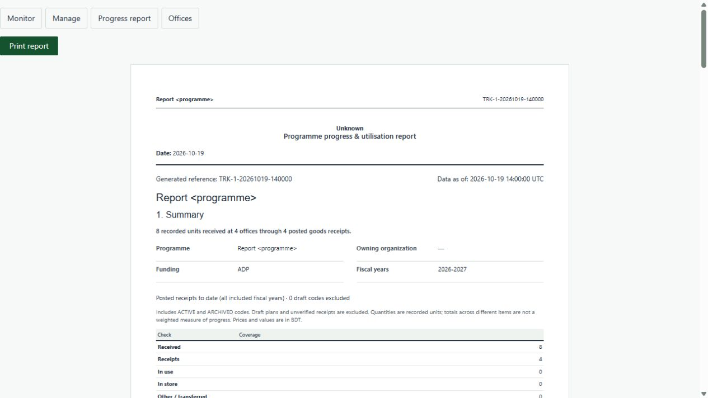
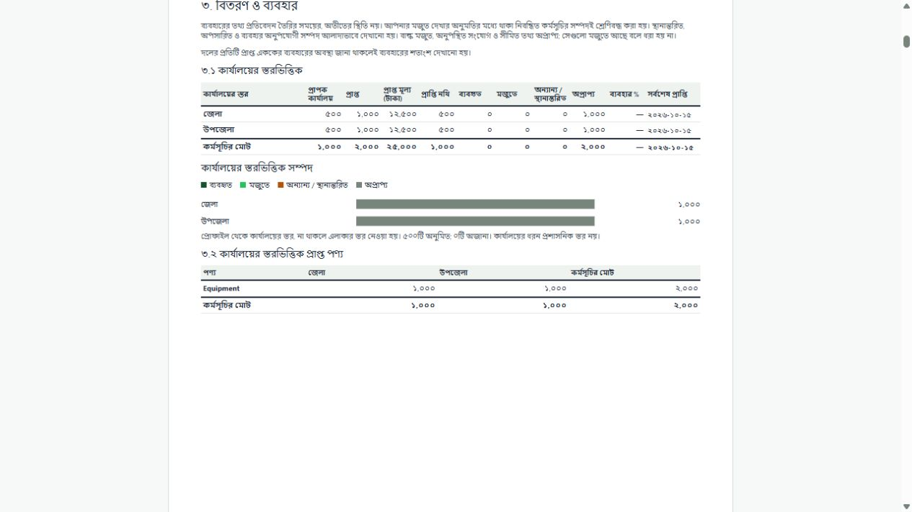
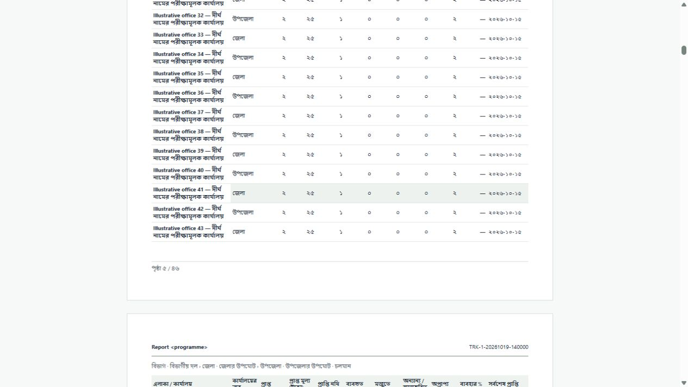
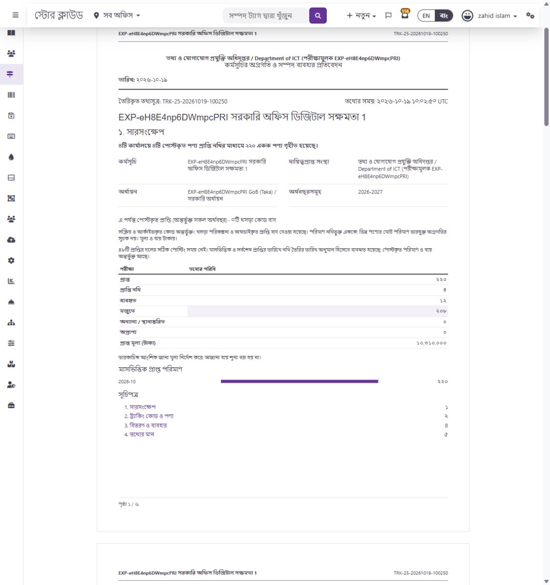
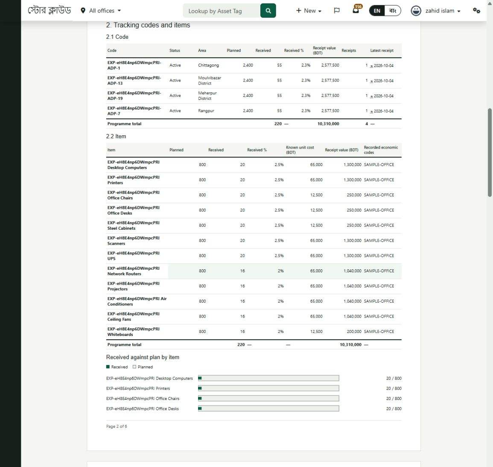

# Option B implementation and verification

Recorded 19 October 2026, Asia/Dhaka. Implements the [Option B plan](../plans/tracking-report-redesign/option-b-implementation-plan.md). No deployment or commit was performed.

## Implemented

- Replaced the existing named programme report with the summary, code/item progress, office-level totals, item/level matrix, geographic office list, charts and data-quality sections. Existing report links and route permissions remain in place.
- Added `ProgrammeReportService`, which authorizes the programme on every invocation and builds a fresh read model within a transaction. Raw metadata queries are bounded by the authorized programme's identifiers. No monitor or portfolio metric definitions were changed for this report.
- Added the nullable organization-owned `office_level`, its allowed-value constant and the existing guarded hub editor's validation, persistence, labels and audit detail. Other hub forms preserve the level when they omit the field. No new endpoint, ability, role or permission bypass was added.
- Reused the document, ledger table, key/value, button and alert components, existing theme registry, theme tokens and bilingual namespace. Report-only assets use `.gs-tracking-report` scoping. The prototype's shell, theme selector, generated data and verification mark were not copied into application behavior.
- Added font-aware measured pagination, repeated table headings, geographic continuation paths, subtotal/first-office grouping, contents page references and page X of Y. Oversized content falls back to the full flowing report with a warning rather than clipping it. The print handler prepares a separate frame with the existing styles and theme attributes, excluding application navigation and shell spacing.

## Data contract and source mapping

| Figure | Source and interpretation |
| --- | --- |
| Code coverage | ACTIVE and ARCHIVED codes in the authorized initiative. Drafts are counted separately and excluded from plans/actuals. Other states are not included. |
| Planned quantities | Existing tracking metric rules: category target quantity or matrix office allocations. Blanket/missing/unknown plans have no denominator. Item percentages are unavailable when untargeted receipts would otherwise inflate a partial denominator. |
| Actual quantities | Active associations resolved through existing receipt provenance, then independently matched to a currently POSTED receipt and supported product/category line using the existing stock-register type keys. Posting timestamps must be within the generation cutoff; legacy posted records without them use creation dates explicitly marked as estimates. Snapshot-only metadata is insufficient. |
| Reconciliation | Reject wrong destination/category, missing line/document, non-positive quantity and attribution exceeding the receipt line. Serialized assets linked to multiple codes within the programme are quarantined rather than counted twice. Exclusions appear in the summary and quality section. |
| Receipt count | Distinct posted document IDs in each rollup, not summed child counts. |
| Values and unit costs | Current posted line unit cost; no snapshot override. Split values retain sub-cent precision until each rollup is rounded to currency precision; quantities aggregate to four decimal places. Missing or negative costs yield partial known values marked with an asterisk; zero is valid. Unit-cost ranges preserve actual recorded costs. |
| Utilisation | Minimal registered-asset state only, with receipt-origin and current-office inventory checks. In use, in store, other/transferred and unavailable are separate. No asset tags or assignee identities in the report model. Bulk inventory and restricted/unresolved state remain unavailable. |
| Utilisation geography | Original receipt destination, independent of current asset location. These are current states at generation, not a historical inventory reconstruction. |
| Office level | Explicit profile value; otherwise supported mapped-area type, including historic `divison`/`upazilla` spellings. Unknown is retained. No name-based inference or bulk backfill. |
| Geographic hierarchy | Exact mapped `hid` prefixes resolved to geography records and stable IDs. Headquarters and unmapped/incomplete branches remain visible. |
| Quality | Computed numerators/denominators, including not applicable. Economic-code presence is explicitly **not validated** against an authoritative registry. Recorded order references do not certify file availability or matching. |
| Report identity | Generation reference and timestamp, not an issued immutable document number or certification. No QR or public verification route. |

The report covers posted receipts to date across included fiscal years. It does not add forecasts. Totals of recorded units across different items are explicitly not a weighted measure of programme progress. Read consistency relies on the database's transaction isolation; the output is not a persisted snapshot.

## Automated verification

Installed PHP 8.4.15, Xdebug disabled; isolated SQLite fixtures only. Root phpunit.xml was not changed.

- Full GovStore run during integration: **616 tests, 13,711 assertions passed**, 228 MB peak. This preceded the final additional edge-case tests.
- Subsequent focused report, monitor, organization workflow, G1 authorization and theme compliance run: **111 tests, 2,522 assertions passed**.
- After the final duplicate-asset protection, report suite: **31 tests, 273 assertions passed** (includes inherited workflow cases). This also checks that a quarantined asset cannot inflate another asset's utilisation on a shared delivery.
- Additional synthetic office and code/item preview export checks: **2 tests, 15 assertions passed**.
- Report PHP formatting, JavaScript syntax and nine compiled report/hub Blade PHP files passed. Theme asset build succeeded for all six shipped themes; compliance baseline was not increased. Existing theme build, organization UX, tracking correctness and workflow tests were included in the integration run.

Coverage includes revocation between service calls, native-admin-only denial, owning-company boundaries, legitimate cross-company receipt destinations, independent inventory scope, transfers, archived/draft codes, missing costs, fractional quantities, snapshot price tampering, future receipts, wrong categories, over-attribution, duplicate serialized assets, matrix denominators, blanket receipts, geography fallback and translation parity. Profile updates test allowed values, omission preservation, clearing and foreign-office denial.

## Browser and scale evidence

The existing signed-in local session rendered programme 4 in English and Bangla. Original Bangla preference was restored; debug toolbar was absent and no browser warnings/errors were observed in the checked report flow. Its two existing association units lack verifiable posted provenance: the new report explicitly excludes them instead of silently treating the older monitor total as verified actuals. Those source records were not repaired or changed.

Synthetic fixtures came only from the isolated SQLite tests:

| Scenario | Observed result |
| --- | --- |
| Four offices | Four measured A4 sheets; every office retained. |
| 1,000 offices, long bilingual names | 46 measured sheets; all 1,000 offices retained, no measured overflow or stranded subtotal band. Continued tables repeat headings and geographic paths. |
| 120 codes and 120 items | 23 measured sheets in Bangla; all 119 additional long code labels retained and tables paginate without measured overflow. |
| Themes/locales | Classic, Institutional Green light and Digital Blue dark checked across English/Bangla scale cases; see the [browser measurements](tracking-report-2026-10-19-browser.json). |
| Data build | 27 queries for both four and 1,000 offices; approximately 0.009 s and 0.815 s respectively on this machine. This is an isolated SQLite observation, not a production latency guarantee. |

Screenshots contain synthetic data only:

## Development effects and cleanup

Verified the local MySQL target as `snipeit` before applying only `2026_10_19_000001_add_office_level_to_location_profiles.php`. Profile count remained **57 before and after**; no office-level backfill or live profile mutation was performed. No access-mode changes, grants or business test records were created. Audit history was preserved.

Temporary preview HTML, helper scripts and the loopback preview server were removed/stopped after verification. Generated theme bundles are local build output. Unrelated pre-existing tracking/portfolio changes were preserved.

## Remaining verification and limits

- Native print/save-PDF verification in both locales remains open. The in-app browser's native print invocation blocked browser commands and did not expose a usable PDF preview/export capability. Screen page geometry is verified; this does not establish a saved PDF's final page breaks, printer settings or paper output.
- A narrow viewport override still exposed the application's wider layout viewport; this was not sufficient evidence of full mobile usability. The report has a keyboard-focusable horizontal scrolling page region, but a real narrow-device check remains open.
- Live office-level editing was not exercised against existing business profiles; guarded persistence and denial were verified in isolated tests.
- No remote CI run, WCAG certification, production readiness claim or real-world shadow observation was established. Persistent issuance, QR verification and historical utilisation remain outside scope.

## Programme 25 compatibility correction — 19 October follow-up

The user's exact report URL was rechecked in the supplied administrator account through the normal browser sign-in. The original implementation incorrectly assumed product class names instead of the application's `assetmodel` morph key and required a posting timestamp on older POSTED documents. The original test receipt fixture also used the wrong model class convention, so it did not catch this incompatibility.

Corrected the read model to reuse `StockLedgerReader::typeKey()` and corrected fixtures to use the real `assetmodel` convention. Legacy POSTED receipts remain subject to document, category, quantity and cutoff checks; their creation dates are marked as estimates in the summary and a dedicated quality check. No records, permissions or posting states were changed to obtain this result.

Live programme 25 now shows **220 units, four receiving offices, four posted receipts, BDT 10,310,000, 12 in use and 208 in store**. All 48 receipt groups use estimated dates because the four posted documents lack posting timestamps. Six report pages rendered without measured overflow or browser warnings/errors. The exact report URL was left open for review. Credentials were not saved to evidence or source.

Added regression coverage for short/legacy/class morph keys, bulk stock keys, missing posting timestamps, future creation dates and draft exclusion. The report suite passed **32 tests / 283 assertions** after this correction. The combined G1, tracking correctness, monitor and report run passed **121 tests / 2,667 assertions**.

## Implementation review and refinements — 19 October follow-up

Reviewed the current implementation against receipt provenance, tenant/inventory scope, money precision, bilingual rendering and measured pagination. The existing programme authorization and theme conventions remain in use. No live business records, schema, roles, grants or access-mode settings were changed during this review.

Corrections and improvements:

- The shared receipt resolver now uses the stock ledger's canonical type keys for legacy movement-to-line matching and returns the exact matched document-item ID. Ambiguous product lines or conflicting delivery links cannot establish a report actual. This also removes the report's redundant delivery lookup.
- Split receipt shares retain precision until aggregation, preventing early currency rounding from inflating the overall value. Negative costs remain unknown; zero costs are valid. The value note explains partial values and possible displayed rounding differences.
- Utilisation requires registration against the exact verified receipt line. Missing status metadata stays unavailable instead of being labelled as other/transferred. Existing checks on both receipt destination and current inventory scope remain intact.
- Code and item tables display programme totals, using a distinct receipt count and leaving unavailable overall planning percentages blank. Estimated latest dates are marked beside the affected figures with a translated explanation. Chart legends and accessible descriptions explain the displayed states.
- Office names now show hierarchy indentation inside the cell, respecting the kit's cell-padding rules. Pagination clones an empty table shell rather than the entire office list for every continued page, reuses available space before the office list, and displays a translated preparation message. Print preparation removes stale frames and reports stylesheet-loading failure safely after a bounded wait.

Verification for this review:

- Focused report, monitor, tracking correctness, G1 authorization and theme-compliance suites: **128 tests / 2,697 assertions passed**. Added regressions cover legacy movement keys, ambiguous lines, split sub-cent values, missing asset status and negative/zero costs.
- Subsequent bilingual render and scale-export checks: **3 tests / 25 assertions passed**. The final office-layout adjustment also passed its export check (**1 test / 11 assertions**).
- PHP formatting, JavaScript syntax and Git whitespace checks passed. The theme build passed for all six themes. Report styling continues to use registered package assets, existing tokens and `.gs-tracking-report` scope.
- Live programme 25 was checked in English and Bangla; the original Bangla preference was restored. It still displays **220 received, four offices, four receipts, BDT 10,310,000, 12 used and 208 in store**. Six measured sheets rendered with no overflow or captured browser warnings/errors.
- Final synthetic checks retained all offices with no measured overflow or stranded subtotal bands: four offices in English/Institutional Green (**four sheets**), 1,000 offices in Bangla/Institutional Green and English/Digital Blue (**63 sheets each**), and 120 codes/items in Bangla/Classic (**22 sheets**). These supersede the earlier page counts: visible hierarchy indentation wraps long office names onto more lines. See [review browser measurements](tracking-report-review-2026-10-19-browser.json).
- The data build used **26 queries** for both four and 1,000 offices; observed isolated SQLite times were **0.011 s / 0.896 s**. These are local observations, not production guarantees.

The earlier native print/save-PDF and real narrow-device verification limits remain open. No remote CI or accessibility certification is claimed. Temporary synthetic preview files and the owned loopback server were removed after these checks; audit history and existing business data were preserved.

